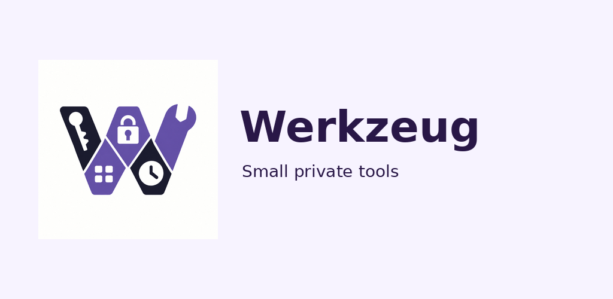
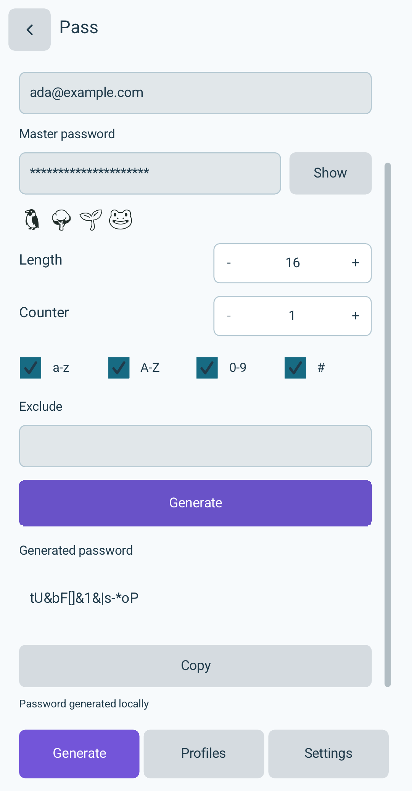
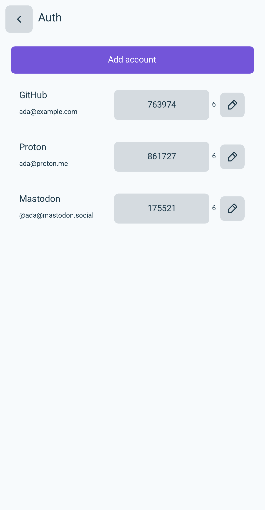
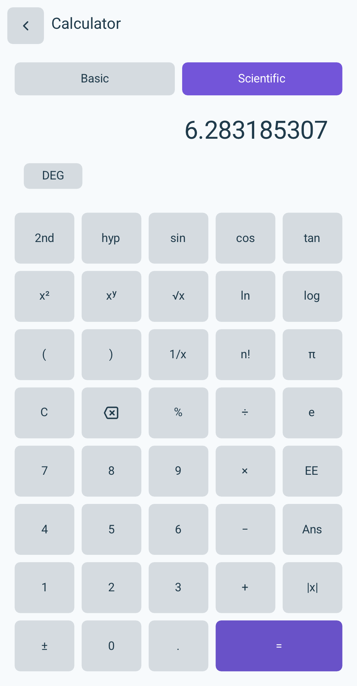

  

# Werkzeug

Small, private tools for everyday life. Generate passwords, manage sign-in
codes, calculate and keep time in one free, open-source app.

[Try it online](https://werk.waozi.xyz/app/)
· [Download the latest release](https://github.com/waozixyz/werk/releases/latest)
· [What's new](CHANGELOG.md)

## Your everyday tools

- **Pass:** generate the same password from your site, login, master password and settings. Save profiles without keeping a password database.
- **Auth:** keep two-factor sign-in codes together. Import existing accounts, rename them and copy a code when you need it.
- **Calculator:** everyday arithmetic and scientific functions, with a keypad or keyboard.
- **Clock:** see the local time and use a stopwatch that keeps running while the app is closed.
- **Workbook on Linux:** edit spreadsheets with sheet tabs, familiar menus and portable workbook files.

  
  
  

## Make it yours

Choose light or dark appearance, an accent color and your profile picture.
On Linux, open each tool directly from its own application-menu or Desktop
shortcut, with its own icon.

## Your data and choices

Password generation and local tools work on your device. Account sync and
node connections are optional. Each tool keeps its own private files.

Werkzeug was formerly Pass. The new Android package installs separately from
the legacy Pass app; the older app and its data remain available.

[F-Droid submission (draft)](https://gitlab.com/fdroid/fdroiddata/-/merge_requests/53912)
· [Report a problem](https://github.com/waozixyz/werk/issues)
· [Build, command-line tools and data details](docs/development.md)

BSD 3-Clause. See [LICENSE](LICENSE).
